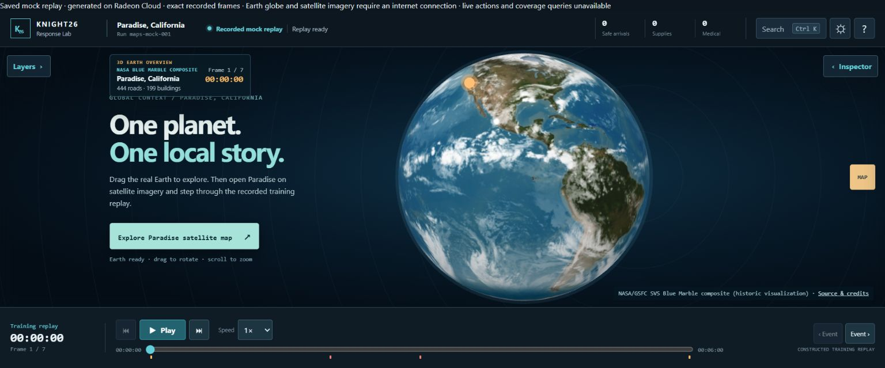
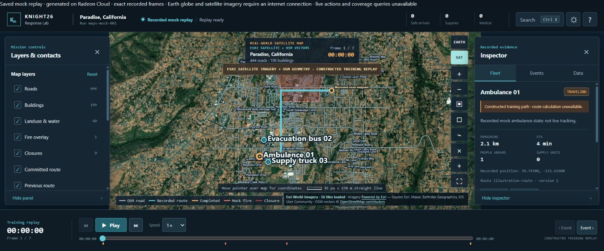
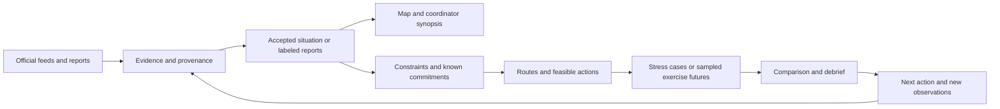

<div align="center">

# 🌍 BayMax

### Understand the disaster. Rehearse the response.

Source-backed situation maps, vehicle-aware routing, and aid-planning exercises for civilian response coordinators.

**Explore a place. Inspect the evidence. Compare your next move.**



*Saved development preview under the earlier Knight26 name. This image shows a constructed training replay and historical Earth imagery.*

**[Start exploring](#quick-start) · [Try an exercise](#first-five-minutes) · [See the evidence](#current-status)**

</div>

---

<div align="center">

**[Why BayMax](#why-baymax) · [Features](#features) · [Quick Start](#quick-start) · [First Five Minutes](#first-five-minutes) · [Current Status](#current-status) · [Under the Hood](#under-the-hood) · [Data & Costs](#data-and-costs) · [Documentation](#documentation)**

</div>

---

<a id="why-baymax"></a>
## 🌱 Why BayMax Exists

A response coordinator needs to connect reports, roads, people, and available resources while conditions keep changing. A map helps explain where something happened; a planning exercise helps explore what to do next.

BayMax brings these tasks into one intended workflow: understand an attributable situation, identify the unknowns, then rehearse aid decisions against explicit constraints. Evacuation and urgent medical needs come first, essential supplies next, and efficient travel after that.

> Every plan should explain what it knows, what it assumes, and what could change the next decision.

The project starts with bounded wildfire and recovery cases, including a Paradise, California road network. Wider geographic coverage and other preparedness scenarios extend that same response loop. The established scope is training and advisory use; exercise outcomes describe simulated service and resource use.

---

<a id="features"></a>
## 🎛️ What You Can Explore

These are the main experiences being assembled. The [status table](#current-status) explains how far each has been demonstrated.

- **🌐 Earth to local map:** Explore an Earth overview, inspect a place, and move into a bounded local map with roads, buildings, and satellite context.
- **📍 Attributable situation cards:** Inspect accepted hazard records, their original sources, timestamps, and the information still missing.
- **🚌 Vehicle-aware routes:** Exercise paths for evacuation buses, ambulances, and supply trucks against directed roads and vehicle-access restrictions.
- **🧭 Trips that carry forward:** Routing components preserve underway commitments and simulated trip progress, and handle changed access with reroutes or explicit unreachable states.
- **📦 Aid constraints:** Exercise seats, stock, destination capacity, deadlines, and existing commitments before treating an action as feasible.
- **🔀 Alternative futures:** Compare strategies from the same starting information under declared assumptions. Authored stress cases carry no probability weights; sampled exercise futures describe only their stated model.
- **⏯️ Practice and replay:** Advance an exercise, inspect events and alternatives, and review simulated requests served, unmet needs, and resources used.
- **📄 Report interpretation:** A developing local-model workflow proposes grounded claims from text. Original reports, proposed interpretations, and accepted facts retain separate labels.



*Saved map preview: Esri imagery and OpenStreetMap geometry provide geographic context. The displayed routes, vehicles, and fire overlay are authored replay data. This screenshot does not demonstrate a connected route executor or live fleet tracking.*

---

<a id="quick-start"></a>
## ⚡ Quick Start

Product development, model execution, simulation, and rendering use the supplied Radeon Cloud server. Chrome provides the interface. The commands below launch the included constructed replay, using the dashboard entry point on `main`; this README update has not rerun the product.

### Start the training replay on the server

From the product checkout, choose an unused loopback port:

```bash
cd /workspace/knight26/repo
/opt/venv/bin/python -m services.dashboard_api.server --host 127.0.0.1 --port 8875
```

The service uses the included Paradise geography and replay fixtures. Open it through the project's authorized browser-access route. The URL on the server is `http://127.0.0.1:8875`; access from another computer requires an existing approved connection. This command does not install dependencies, restart Jupyter, or configure browser access.

### Inspect an accepted situation

The service's optional `--incident-publication-dir` argument reads a trusted publication directory. Without one, the default replay does not supply accepted live incident facts. See the [Situation integration guide](services/dashboard_api/SITUATION.md) and [incident artifacts](integration/INCIDENT_ARTIFACTS.md) for the data contract.

Saved project evidence also includes a signed-in JupyterLab Situation panel that follows publication changes and a separate fixed-snapshot Earth export. Those instance-specific review routes are distinct from the default replay server above. See the [evidence notes](docs/README_EVIDENCE.md) for their demonstrated scope.

---
<a id="first-five-minutes"></a>
## 🕐 The First Five Minutes

Start with the constructed replay launched above. Accepted-source inspection is an optional separate step that requires a trusted publication and its authorized review surface.

1. **Check the mode.** Confirm that the interface identifies the constructed replay. Its vehicles, routes, and fire overlay belong to the authored exercise.
2. **Explore the Earth.** Rotate and zoom the globe, then inspect the historical imagery attribution. Accepted earthquake points require the separate source-backed export described in the evidence notes.
3. **Enter Paradise.** Switch to the local map. Use satellite imagery for orientation and the OSM layers for recorded roads and buildings.
4. **Inspect a vehicle.** Open its replay card and inspect the displayed path, position, and ETA. These values belong to the constructed exercise.
5. **Step through the replay.** Advance the timeline and inspect the event changes. For computed trip and policy examples, follow the [routing evidence](services/routing/ARTIFACTS.md) and [training results](evals/planner/TRAINING.md).

With authorized access to a trusted Situation publication, separately inspect a source card and check its source, observation time, snapshot cutoff, and unknown fields. The default replay supplies no accepted incident records. The intended complete exercise adds feasible next-action comparison, execution, new observations, and a debrief; connecting that loop to the accepted situation remains ongoing work.

---

<a id="current-status"></a>
## 📋 What's Demonstrated

The following summarizes saved evidence reviewed on **October 10, 2026**. Component tests, browser previews, and research each establish different things. The [detailed review](docs/README_EVIDENCE.md) records their scope and links to the underlying checkpoints.

| Area | Evidence-supported state | Remaining connection |
|---|---|---|
| Earth and local map | Browser-checked saved globe/map exports, bounded Paradise OSM geometry, and satellite context. | Continuously updated interactive Earth routing remains gated; local overlays are constructed replay. |
| Official hazard display | Reviewed NWS/USGS publications and a signed-in Situation panel that follows accepted publication changes. | Ongoing source freshness and complete response-case assembly. |
| Routing and trip state | Tested vehicle-access, traversal, commitment, rerouting, and simulated progress components. | Accepted incident constraints joined to the map and route executor. |
| Aid exercises and comparisons | Authored training runtime, constraints, policy comparisons, replay, and UI evidence. | Complete accepted-situation-to-projection integration and evaluated planner advantage. |
| Text and document intake | Reported-layer integration and a pinned Qwen3-4B runner are documented. | Verified GPU inference, OCR evaluation, and the full document-to-map flow in the cited review. |
| Wildfire propagation | Source research and physical-engine dependency work are recorded. | A validated physical forecast connected to the mission. |
| AMD graphics | ROCm tensor smoke evidence and native W7900 mock-scene renders are recorded. | Genuine FSR4 dispatch and product-level performance evidence. |

Verified operational needs, road closures, fleet positions, stocks, and destination capacities are absent from the accepted situation described by that review. They remain **Unknown** in that layer. Exercises supply their own explicitly authored values.

---

<a id="under-the-hood"></a>
## 🛠️ Under the Hood

The target architecture connects intake, evidence, geography, and response planning:



The demonstrated source-to-display path is narrower: **NWS/USGS source bytes → accepted records → immutable publication → signed-in Situation panel**. The broader diagram describes the intended integration.

| Layer | Technology and responsibility |
|---|---|
| Geographic interface | Three.js Earth view, historical NASA Blue Marble, Esri imagery, OSM roads/buildings, and project-authored map controls. |
| Evidence and publication | Python services retain source identity, hashes, times, revisions, unknowns, and immutable snapshot/publication identities. |
| Routing | Directed road graphs, mode-specific access, trip commitments, changing access, and simulated vehicle progress. |
| Exercise planning | Reproducible training cases, resource constraints, strategy comparison, replay, and debrief metrics. |
| Local models | Hugging Face model/runtime work for grounded interpretation; model inference and OCR have separate validation gates. |
| Compute and graphics | Radeon Cloud W7900, PyTorch/ROCm, native-render experiments, and a separate FSR4 validation effort. |

See the [situation workflow](services/dashboard_api/SITUATION.md), [planning loop](evals/planner/TRAINING.md), and [pathfinding design](coordination/PATHFINDING_AND_TRACKING.md) for the contracts and intended behavior.

---

<a id="data-and-costs"></a>
## 🗂️ Data, Access & Costs

BayMax keeps the origin of each layer visible:

| Input | Role | How to read it |
|---|---|---|
| NWS and USGS | Accepted weather-alert and earthquake observations in reviewed publications. | Check each record's source and timestamps. Regional alerts remain regional. |
| OpenStreetMap | Bounded Paradise road/building geometry and access tags. | Mapped geometry does not establish present road safety or disaster damage. |
| NASA Blue Marble and Esri imagery | Earth and local-map visual context. | Historical composites and imagery of unknown acquisition date do not establish current conditions. |
| Authored exercise data | Requests, fleets, capacities, closures, delays, and future assumptions. | Interpret outcomes inside the declared scenario. |
| Additional feeds and models | Research and candidate integrations. | A source-register entry does not establish a connected feed. |

The [evidence and source notes](docs/README_EVIDENCE.md) explain the distinction between acquired inputs and candidate integrations. Map-provider attribution and upstream code provenance are recorded in [map references](web/REFERENCES.md).

Cloud runtime consumes the supplied compute allocation; map providers and optional model/API services have their own access, quota, and licensing requirements. Confirm the current allocation and provider terms before running workloads. The [Maps/AMD review](docs/reviews/maps_amd.md) describes the recorded graphics evidence and remaining gates.

---

<a id="documentation"></a>
## 📚 Go Deeper

| Looking for… | Read |
|---|---|
| Product evidence and demonstrated scope | [README evidence notes](docs/README_EVIDENCE.md) · [Independent review index](docs/reviews/README.md) |
| Situation publication and map integration | [Situation contract](services/dashboard_api/SITUATION.md) · [Incident artifacts](integration/INCIDENT_ARTIFACTS.md) |
| Routes, trips, and vehicle tracking | [Pathfinding design](coordination/PATHFINDING_AND_TRACKING.md) · [Routing artifacts](services/routing/ARTIFACTS.md) |
| Training cases and strategy comparisons | [Planner overview](evals/planner/README.md) · [Training guide](evals/planner/TRAINING.md) |
| Map interface and provenance | [Web checkpoint](web/CHECKPOINT.md) · [Map references](web/REFERENCES.md) |
| Text intake and wildfire model boundaries | [Intake service](services/intake/README.md) · [Wildfire service](services/hazards/wildfire/README.md) |
| Architecture and integration review | [Structure and integration](docs/reviews/STRUCTURE_AND_INTEGRATION.md) |
| Requirements and competition evidence | [Requirements and judge evidence](docs/reviews/REQUIREMENTS_AND_JUDGE_EVIDENCE.md) |
| Contracts and domain vocabulary | [Contract overview](coordination/CONTRACTS_V1.md) · [Glossary](coordination/GLOSSARY.md) |

Linked checkpoints describe the state at their recorded dates. Use their exact scope when assessing implementation or access.

---
<a id="contributing"></a>
## 🤝 Development & Review

The project repository is [jrile018/knight26](https://github.com/jrile018/BayMax). Workstream owners develop and validate changes in their Radeon Cloud worktrees, document evidence in Discussions, and submit PRs for review. Use the [review index](docs/reviews/README.md) and [coordination overview](coordination/README.md) to understand the existing scope and contracts.

Useful contributions connect the existing components into one bounded response case, strengthen source grounding, or verify an exercise against its stated assumptions. Every change should keep official observations, reported claims, historical context, and authored training state identifiable.

---

<a id="credits"></a>
## 🙏 Credits & Licensing

The README presentation follows [God's Eye View](https://github.com/bilawalsidhu/gods-eye-view/blob/main/README.md): a visual introduction, section navigation, feature tour, walkthrough, and technical reference. BayMax also records adaptations of its MIT panel-layout helpers from upstream commit `591f299d11f38a612629a274463196d57ae3862e`; the Earth view is a project-authored Three.js integration. See the [origin review](docs/README_EVIDENCE.md) for that distinction.

Geographic context credits NASA/GSFC, Esri and its imagery partners, and OpenStreetMap contributors. Hazard records preserve the relevant agency attribution. Code, data, imagery, and models carry separate licenses; the upstream MIT license does not cover every provider asset. See [map references](web/REFERENCES.md), the [upstream MIT notice](web/UPSTREAM_LICENSE.txt), and the [training helper provenance](evals/planner/vendor/gods_eye_view/PROVENANCE.md) for the recorded code and asset origins.
