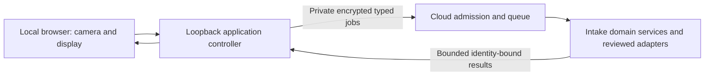

# Local camera and cloud processing bridge

**Status: PROPOSED / UNBUILT / UNRUN.** This is a documentation checkpoint of the selected architecture and implementation requirements. The design has received a planning review. No bridge implementation, synthetic round trip, live camera test or model evaluation is established by this document. The future implementation must be independently reviewed against its actual source and executed results.

## Purpose

Run the intake camera and application display on the user's computer, send permitted operation inputs to the existing cloud service, and return bounded results. This provides an application access path independent of an unavailable hosted browser route. It does not repair that route or establish injury-assessment accuracy.

Smooth camera video stays local. The cloud retains canonical attendance, care, image normalization and reviewed model processing. Only specifically permitted sampled or selected images leave the user's computer. The bridge is a closed application interface, not a general file, command or internet proxy.

## Placement and ownership

| Component | Proposed responsibility |
| --- | --- |
| Browser | Explicit camera activation, local video, selected/sample raster display and human review |
| Local controller | Loopback hosting, request guards, fixed private transfer profile, deadlines and lifecycle |
| Cloud adapter | Current authentication and assignment, fixed domain operations, admission and result validation |
| Existing intake integration owner | Canonical database/shared-source changes, domain transactions and final integration |
| Existing face/model owners | Native interfaces, models, evaluation and permitted runtime behavior |
| Project coordinator | Separate execution admission, limits and preservation of existing services |

One local-controller author owns the proposed `tools/intake_bridge/` package. The existing intake integration owner owns proposed `services/arrival_intake/bridge_protocol.py`, `operations.py`, `transaction_hooks.py`, `bridge_ledger.py`, `bridge_queue.py` and `bridge_worker.py`, plus existing browser/service changes. Source proposals in parallel preparation do not transfer canonical integration ownership. Consumers use one adopted protocol source; competing copies or aliases are not accepted.

## Local browser boundary

Bind the controller only to `127.0.0.1`, with one canonical `http://localhost:<approved-port>` origin. Actual secure-context, camera API and permission behavior must be tested. Start camera is an explicit user action; page load never starts capture.

Retain application bearer authentication. Protect every operation, including private reads, with an exact Host allowlist, allowed Origin, a memory-only controller-session nonce, JSON/method/path checks and early body limits. No wildcard CORS. Preserve restrictive CSP, private no-store responses, frame denial, camera-self and disabled microphone policy. Rotate the nonce on retirement and restart; logout clears browser authentication.

SSH configuration, keys and fixed transfer choices remain outside browser inputs and outputs. Requests cannot choose arbitrary commands, hosts, ports, paths, URLs, models or grants. The design requires supported encrypted file transfer with host verification; it introduces no port forwarding or command-stream HTTP substitute.

## Closed operation interface

The exact operation names are proposed protocol values. Each operation keeps its existing domain-specific input schema, role, assignment, revision and error behavior. Unsupported operations or undeclared fields are rejected.

| Family | Closed operations |
| --- | --- |
| Identity and intake reads | `identity.read`, `intakes.list`, `intake.read`, `intake.aggregate`, `intake.history`, `intake.reviews`, `arrival.read` |
| Attendance and intake writes | `arrival.confirm`, `intake.finish`, `attendance.correct` |
| Photos and assessment | `photo.read`, `photo.attach`, `assessment.request` |
| Human care workflow | `concern.report`, `observation.record`, `review.complete` |
| Capture lifecycle | `capture.open`, `capture.status`, `capture.close`, `capture.preview`, `capture.select` |
| Bridge controls | `bridge.status`, `job.status`, `job.cancel`, `controller.retire` |
| Synthetic transport milestone | `fixture.inspect`, disabled by default and restricted to an immutable owned synthetic-image allowlist |

`fixture.inspect` returns labeled integrity information and a permitted raster when configured. It performs no native model invocation or domain mutation. Its success cannot establish model, participant, preview or complete application acceptance.

A proposed Job contains exactly `protocol`, `controller_session_id`, `job_id`, `operation`, `targets`, `payload`, optional `image`, `generation`, `created_at` and `deadline`. Controller/job identifiers are generated canonical lowercase UUIDs. Domain targets remain candidates for authorization and never become filesystem paths. Image metadata contains only media type, byte length and raw SHA-256.

Reject duplicate JSON keys, nonfinite numbers, wrong exact types and extra fields. The transport digest covers sorted compact canonical UTF-8 Job JSON. It is an integrity/idempotency identifier, not native model evidence, consent or authority. Credentials and upload proofs remain separate private transient material and never enter public manifests, logs or result receipts.

Terminal results bind protocol, controller/generation, immutable job and request digest, operation, outcome, existing HTTP semantics, current domain/image identity and accepted source configuration. Fixed `body.json` and `media.bin` descriptors carry size/hash/type, never request-chosen filenames. Outcomes are `queued`, `running`, `completed`, `denied`, `conflict`, `expired`, `canceled`, `unavailable`, `failed` and `commit_unknown`. A failed transport is not a successful negative assessment.

## Media admission and private exchange

Authenticate and authorize media metadata before any pixel upload. The cloud issues a private one-use UploadTicket bound to the actor, controller/generation, job/request digest, image digest/length, purpose and original expiry. The controller receives a fixed private ticket carrier and sends a separate opaque proof with media only after validating the matching live ticket. The cloud records a proof hash, rechecks current authority, verifies image bytes and atomically consumes the reservation.

Non-media operations reject images and proofs. Failed metadata authorization produces zero image transfer. Wrong, foreign, stale or revoked proofs cannot admit processing. Same-ID/digest/owner recovery can resolve the live reservation or original terminal outcome; proof rotation cannot extend the original deadline. Consumed proof replay cannot produce a second image-processing or mutation effect.

Use private per-session spools, generated names, temporary upload directories and atomic ready/claim/result publication. Reject extra files, symlinks/reparse escapes and incomplete manifests. Windows private creation requires a protected operator-only DACL before writing; a POSIX permission value is not Windows confidentiality evidence. Hash and bound downloads before use. Keep credentials transient and exclude private images, permissions and receipts from public repositories.

The cloud must reauthenticate against the current registry and check assignment, purpose, capture, revision and permission before execution and inside the final writer transaction. Current-authority synchronization is held through writer commit/rollback; model work remains outside that lock and the database writer.

Each mutating operation supplies trusted transaction hooks to its existing writer. Domain effect and bounded terminal recovery receipt commit in the same database transaction. Queue admission is a separate short transaction, not an outer transaction around existing domain writers. A crash after commit but before result publication reconstructs the original receipt. An uncertain result stays `commit_unknown`; it must not trigger an automatic new-ID mutation.

Status, close and cancel controls remain serviceable while selected processing is pending. Cancellation cannot undo an already committed domain effect. Cleanup removes transient files, proofs, private receipt/image/provenance links and credentials, while retaining permitted independent attendance/care history and irreversible retirement protections. Cleanup failure is visible and blocks new private work.

## Limits, timing and image identity

| Item | Proposed bound |
| --- | --- |
| Job and result manifests | 64 KiB each |
| JSON result body | 256 KiB in its separate body file |
| Selected image | 5 MiB encoded, 12 million decoded pixels |
| Selected normalization | Apply orientation, strip metadata, RGB, long edge at most 1280 pixels |
| Preview image | 512 KiB encoded, 2 million decoded pixels |
| Preview rate and lifetime | At most one per second, one in flight, two-second byte lifetime from sampling |
| Capture session | At most 120 seconds and never beyond current permission; at most 240 accepted previews |
| Private photo display | At most five seconds from local monotonic request start, clamped by permission expiry |
| Ordinary job deadline | At most 120 seconds from request start, clamped by current authority and project limits |
| Private spools | At most 64 MiB per controller, 128 MiB aggregate; admission can impose lower bounds |

Preview is **memory-only and disabled by default**. Enable it only after actual supported in-memory local transport and transient cloud RAM placement, independent expiry supervision and conservative clock/latency evidence pass review. No ordinary-disk preview exception is selected. If those requirements cannot be met, show preview unavailable and leave continuous-preview acceptance incomplete. Admission, retry and delayed results never restart byte lifetime or display lease.

The cloud returns the normalized image identity, capture/arrival revisions, dimensions and digest from the same authorized snapshot as the bytes. Apply results only to the matching actor/session/view generation and current domain identity. Draw localization on its matching sampled raster, never on newer live video or a different selected image. Raw upload integrity does not establish normalized/native evidence.

For Stop, Retake, logout, navigation, expiry or access denial: snapshot the old generation; synchronously retire it, advance generation, rotate nonce and release its action ownership **before** any teardown, callback or await. Then best-effort stop tracks/transfer and retire the saved cloud generation. A fresh action cannot wait for cloud acknowledgment, and an old completion/finally cannot clear new ownership.

Restart uses a new controller identity/nonce and sweeps expired private state. Never restore tokens or live proofs from logs. Fresh same-actor authorized recovery may retrieve old job/capture status, but must refresh current detail/photo before display. Recovery information is not a new display permission.

## Implementation sequence and acceptance

1. Freeze/adopt one protocol, exact schemas, factories, operation coverage, limits and source identities.
2. Extract existing domain operations with current-authority guards and transaction-bound recovery hooks.
3. Implement the private cloud admission ledger, one-use tickets, independent controls and cleanup.
4. Implement the loopback controller security boundary and verified private storage.
5. Implement supported bounded file exchange, atomic staging, immutable retry and conservative deadlines.
6. Integrate the existing browser and repair pending-permission/playback action ownership and atomic photo identity.
7. Execute one owned nonpersonal synthetic selected-image round trip through `fixture.inspect`, verifying exact input/result identities, controls and cleanup. No model or participant claim follows.
8. Separately admit actual camera/application/model acceptance with consenting adult participation and permitted data use.

Independent planning review identified and resolved interface, preview-placement, ticket, fixture, ownership and retirement-order inconsistencies. This is evidence about the written design only. Planned synthetic/source controls and actual acceptance remain **UNRUN** for this bridge checkpoint. Existing camera action-ownership and photo-identity repairs are still implementation obligations; this document does not assert their completion.

Future source controls must exercise hostile origin/Host/nonce/body input, authority revocation at writer barriers, all mutation crash/retry boundaries, consumed-proof replay, blocked processing with responsive cancel/status, clock uncertainty/expiry, Windows storage failures, orphan cleanup, restart recovery, deferred permission/playback, stale raster identity and old-finally/new-action races. Import/collection failure is not the intended behavioral assertion result. Every acceptance receipt must identify exact source, dependencies, input, actual command, exit status and limits.

Actual camera testing additionally needs reviewed supported private transport, evaluated compatible models, current runtime/permission bindings, separate browser and image-use consent, human care review, visible Yes/No/Unsure behavior, narrow/desktop workflow checks and end-of-session deletion. A normal-appearance versus simulated-bruise-makeup comparison is staged demonstration evidence, not actual-injury or clinical validation. “No visible concern detected” cannot mean medical clearance.

Publication of this proposed design authorizes no camera capture, model invocation, compute/resource grant, service restart, public application exposure, default media retention or change to existing execution limits. Implementation, test and demonstration readiness must be established separately.
