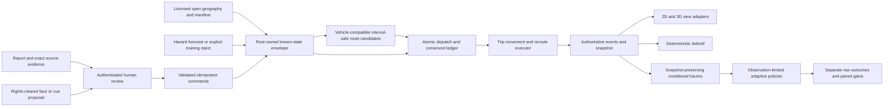

# Proposed structure and integration gates

Review scope: accepted Knight26 aid-coordinator training mission, read-only product review at seven current owner PRs, including changed Maps/AMD/HF heads and the new routing/casualty deltas. Exact pins and cutoff are in the review index. These are proposed integration boundaries, not implemented features or authority to merge worker PRs. The canonical main seed has only five coordination Markdown files; there is no executable shared contract, application package or integrated mission on main.

## One authoritative mission

The learner selects a bounded eligible area, inspects needs/resources, gives a dispatch reason, commits a feasible action, advances server time, receives a closure/report, adapts at a physically reachable point, and sees counted service plus a factual debrief. A known step can branch into paired conditional futures without changing the actual mission. All product computation stays on Radeon Cloud. Views consume server facts.

Sampled hidden truth may affect the evaluator's physical outcomes; it cannot enter a policy view, a route decision or an actual known-state envelope before its observation is released. Face cues cannot create urgency/diagnosis; fictional case facts and human decisions control exercise needs. Unknown values are explicit.

## Ownership and directory proposal

| Boundary | Owner | Recommended responsibility and placement |
|---|---|---|
| Shared schemas and known-state lifecycle | Coordinator | `contracts/` versioned executable records/JSON schemas and `services/simulation/` command, clock, event-log and snapshot service. This is currently missing. Freeze fields before owner adapters. |
| Geography | Maps | `services/geography/`: sourced raw bytes, directed stable edges, CRS/origin and speed/access assumptions; a separate source manifest per actual AOI. Paradise cloud cf5251 has parsed source-hashed geometry and graph; its31 scoped checks do not close AOI-validation defect or establish Gainesville data. It cannot stand in for Gainesville. |
| Routing | Routing | `services/routing/`: full-edge interval checks, reference/candidate search, trip movement/replan/stranding. Import shared primitive types or convert explicitly; avoid a second geography authority. |
| Aid ledger | Routing with coordinator contract | `services/planner/ledger/`: atomic vehicle/person/stock/need/destination reservations, terminal exactly-once service, versioned serialization/restoration. PR8 head6ca28e2 now supplies this dependency with actual-ledger fictional replay and52 tests. Shared serialization/restoration and sourced integration remain absent; historical d763 used stubs only. |
| Hazard engines | Wildfire | `services/hazards/wildfire/`: explicit backend/fidelity, field/grid/source/time records and road projection. Local Gainesville rain/flood access is a separate named training inject, not a new hydrodynamics claim. |
| Intake and cases | HF and faces | `services/intake/` and `services/casualty/`: proposals and human receipts. Coordinator owns authenticated command consumption; workers do not directly mutate ledgers. Case rights, face boxes and visible cues remain distinct fields. |
| Conditional evaluation | MC | `services/planner/futures/`, `services/planner/policies/`: restore actual route/ledger snapshot, preserve commitments/history and condition sampled futures; `evals/planner/` holds evaluation worlds/tests and must not become a second product simulator. |
| Dashboard transport | Maps with coordinator action adapter | `services/dashboard_api/`: authenticated server actions and read-only frames; `web/` displays records. Current POST405 replay is a review illustration, not a playable mission. |
| Elevated scene and platform | AMD | `viewer3d/` converts the shared geometry/state into rendering records; `platform/` owns actual runtime probes and genuine FSR4 integration. CPU prepared primitives are not rendered output. |
| Evidence and release | Each owner and coordinator | `evals/<domain>/`, fixtures and hash-pinned manifests; coordinator release manifest links exact final heads, commands, results, data/model versions and demonstration mode. Keep reviewer reports under `docs/reviews/`. |

Keep ownership explicit. Shared schemas, package/release configuration and integration changes require the coordinator's normal review process; this proposal makes no worker edits.

## Actual adapter gaps

| Producer and actual shape | Consumer/gap | Required adapter invariant |
|---|---|---|
| Routing `snapshot()` has `scenario_id/run_id/snapshot_version/time_s/trips/ledger/events/hash` | MC mock snapshot uses `roads/requests/vehicles/ledger/observations/route_catalog`; views have another envelope | Lossless, versioned restoration maps the actual current edge/distance/direction, time, load, person locations, reservations, committed service and event history. Tests branch at loading, traveling, waiting, servicing, completed and stranded states. Reject unsupported versions. |
| Wildfire `edge_access` emits forecast/unknown status, issued/coverage times, closed intervals, source IDs | Routing `SafetySnapshot` has known/issued/horizon, closures/received times, covered_edges/safe_nodes | Preserve stable edge IDs and units, actual receipt time and forecast issue time separately. Unknown/outside coverage stays uncovered. Declare how buffers compose once; do not accidentally apply a hidden second assumption. A forecast is not a verified observed closure. |
| HF accepted command includes report/source/received time/reviewer/revision, mapped entity, claim and idempotency key | No authoritative durable command consumer exists | Authenticate reviewer identity and require the inspected revision for every external edit/review action; bind aliases to graph version/source; atomically apply effect and dedupe key with state version. Repeat delivery cannot add demand twice. Pending/rejected/conflicting/unmapped claims emit no effects. Persist review decisions before restart. |
| Maps `ReplayStore.frame_hash` hashes a complete normalized view frame | Both views are required to share authoritative `snapshot_hash` | Preserve original authoritative `snapshot_hash`; add independent `view_hash` for normalized 2D/3D content. Do not reassign authoritative identity to a format-dependent digest. Audit view transforms and geometry against the same run/time/version/origin. |
| AMD SceneInput has FrameIdentity, metric CRS/origin, metres and typed primitives | No shared-envelope transport or executed native render/graphics proof exists | Use audited envelope conversion, consistent metric origin, explicit CRS transformation and source/fidelity. Preserve route versions and actual trip positions. Descriptor preparation does not establish graphical frame output. |

## Integration order and review order

The human's reading order is 01 maps, 02 wildfire, 03 routing, 04 intake, 05 faces, 06 MC, 07 AMD, with reviewer00 and coordinator00A documents as overview. This is distinct from dependency integration.

1. Coordinator freezes executable envelope, commands/events, ledger-restoration and hash semantics; repairs stale index links and establishes reproducible server test entry points.
2. Integrate PR8's verified actual atomic ledger and fictional trip core under those frozen contracts; close any concrete invariant regressions before attaching a sourced mission. This is the critical path while model/graphics gates progress independently.
3. Connect source-checked geography and hazard forecasts to that mission. Validate coordinates, stable edge identity, horizon/receipt times and unknown coverage; show the actual source date separately from retrieval time in the UI. Preserve synthetic fallback labels until physical input/engine gates pass.
4. Wire authenticated reviewed intake and case receipts into known state. Demonstrate one human accepted command changes demand/access and its next feasible dispatch; unsupported input remains pending/rejected.
5. Display the authoritative event trace in the inspected browser; implement real actions/pause/advance/branch. Assert same run/time/snapshot identity in the elevated view, then actual render proof.
6. Replace MC mock execution with an adapter over actual routing/ledger restoration. Validate nonanticipativity, common heldout seeds, all in-flight phases and failures before presenting the paired gain metrics as integrated strategy results.
7. Collect per-judge runtime and user evidence. Genuine model inference, product ROCm and separately required FSR4 remain explicit gates; source/learner evidence and release/video deadlines remain separate.

Every merge/update remains coordinator/human-owned; no owner self-merge is recommended. A human reading order cannot certify dependency readiness.

## One-mission acceptance boundary

The end-to-end readiness claim needs one exact commit/config/source manifest and trace: start at a real bounded graph (or clearly labeled tiny correctness fixture), commit bus/ambulance/truck actions, record current edge/trail/ETA, reveal a newly available closure, reroute physically or strand explicitly, count actual safe arrival/medical deadline/delivery once, retain unmet demand, and debrief exact events. A duplicate accepted command and a replay cannot duplicate stock or people. Branch while servicing/traveling and show identical first decisions for identical known histories despite different hidden futures. Both enabled views preserve identity and units.

Current main and partial PRs do not demonstrate this chain. Module test counts alone cannot establish it. Review findings are pinned; an updated owner head must be rechecked in changed scope before its finding is closed.
